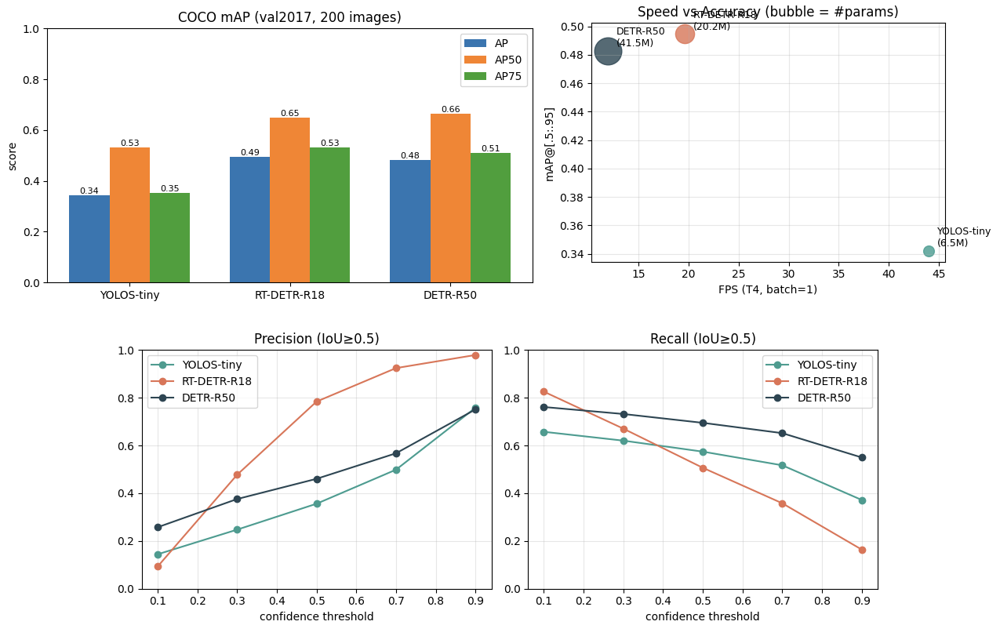
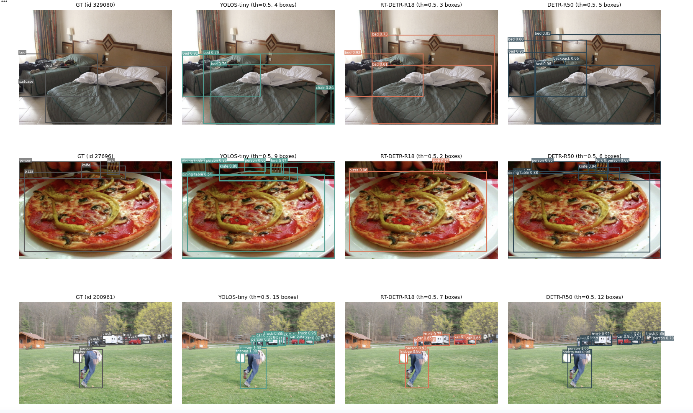

# 5주차 — 객체 검출 (Object Detection) 추론 실습

## 목표
COCO로 사전학습된 Hugging Face 객체 검출 모델 3종을 같은 데이터에서 추론해 **정확도(mAP)–속도(FPS) 트레이드오프**를 비교한다.

## 실험 구성
- **모델**: `PekingU/rtdetr_r18vd` (20.2M), `facebook/detr-resnet-50` (41.5M), `hustvl/yolos-tiny` (6.5M)
- **데이터**: COCO val2017에서 무작위 200장 (객체 1,433개, seed=42)
- **평가**: pycocotools COCOeval (mAP, AP50, AP75, 크기별 AP), 임계값별 Precision/Recall (IoU ≥ 0.5)
- **환경**: Colab Tesla T4, batch=1, FP32

## 결과

| 모델 | 파라미터 | mAP | AP50 | AP_small | FPS (T4) |
|---|---|---|---|---|---|
| RT-DETR-R18 | 20.2M | **0.495** | 0.650 | **0.333** | 19.6 |
| DETR-R50 | 41.5M | 0.483 | **0.664** | 0.238 | 11.9 |
| YOLOS-tiny | 6.5M | 0.342 | 0.531 | 0.083 | **44.0** |

## 배운 점
- RT-DETR은 DETR의 절반 크기로 더 빠르고 정확함 → 구조 개선(하이브리드 인코더, 멀티스케일)의 효과
- 모델마다 신뢰도 점수 분포가 달라 **임계값을 모델별로 조정**해야 함 (최고 F1: RT-DETR 0.5, DETR 0.9, YOLOS 0.7)
- 한계: RT-DETR 일부 레이블명이 COCO 표기와 달라 4,527건이 평가에서 제외 → RT-DETR mAP는 보수적 수치
