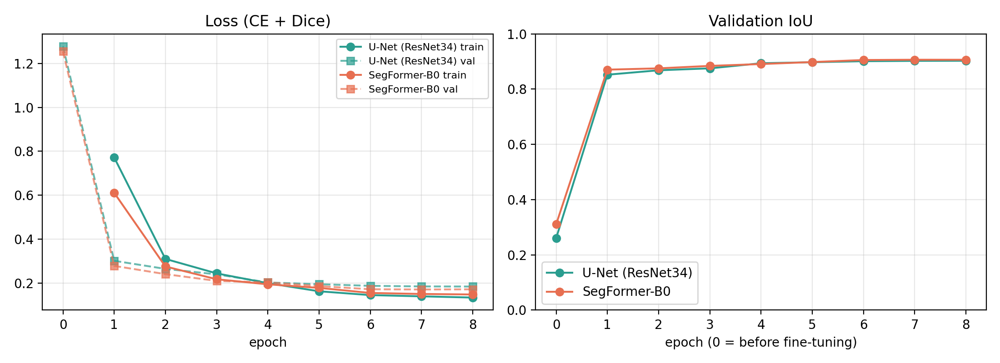
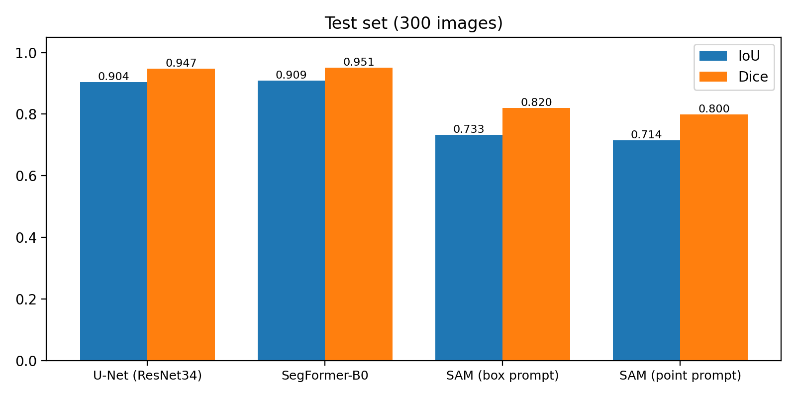
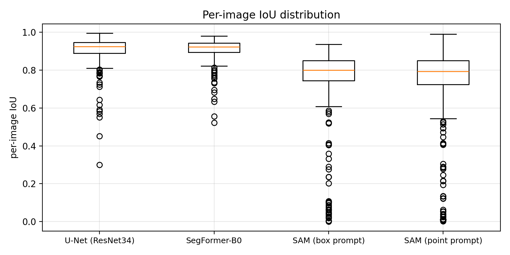
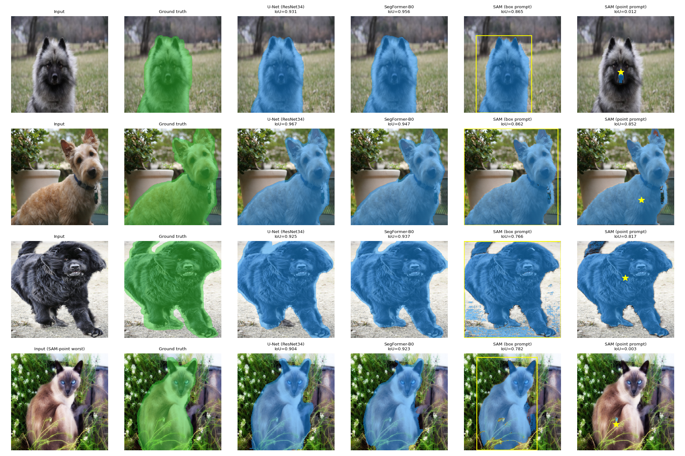

# 6주차 — 세분화 (Segmentation) 실습

## 목표
강의에서 다룬 **클래식 전용 학습 모델(U-Net)** 과 **파운데이션 모델(SAM)** 을 같은 데이터에서 비교해
"전용 정밀 작업은 U-Net, 범용·빠른 적용은 SAM"이라는 강의 결론을 실험으로 확인한다.

## 실험 구성
- **모델**
  - U-Net (ResNet34 인코더, ImageNet 사전학습, `segmentation-models-pytorch`) — 파인튜닝
  - SegFormer-B0 (`nvidia/mit-b0`) — 파인튜닝
  - SAM (`facebook/sam-vit-base`) — 재학습 없이 박스/점 프롬프트로 zero-shot
- **데이터**: Oxford-IIIT Pet (trimap → 반려동물/배경 이진 마스크), 학습 1,000 / 검증 200 / 테스트 300장, 256×256
- **학습**: AdamW 3e-4, OneCycle, batch 16, 8 epoch, CE + Dice loss, FP16 (Colab T4)
- **평가**: 이미지별 IoU·Dice 평균, 경계(trimap=3) 제외 정답 기준 IoU

## 결과 (테스트 300장)

| 모델 | 파라미터 | 학습 전 IoU | **IoU** | Dice | IoU (경계 제외 정답) | 학습 시간 | 추론 (T4) |
|---|---|---|---|---|---|---|---|
| U-Net (ResNet34) | 24.4M | 0.261 | 0.904 | 0.947 | 0.665 | 113초 | 10.1 ms/장 |
| SegFormer-B0 | 3.7M | 0.311 | **0.910** | **0.951** | 0.665 | 62초 | **2.5 ms/장** |
| SAM (박스 프롬프트) | 93.7M | – | 0.733 | 0.820 | **0.705** | 0 | 인코더 410 ms + 디코더 8.8 ms |
| SAM (점 프롬프트) | 93.7M | – | 0.714 | 0.800 | 0.695 | 0 | 디코더 8.8 ms (인코더 공유) |

## 배운 점
- **전이학습 효과**: 1,000장·1 epoch 만에 IoU 0.26 → 0.85+, 8 epoch에 0.90. 과적합 없이 수렴
- **SegFormer-B0**는 U-Net의 1/6.6 크기로 성능은 비슷하거나 약간 높고 추론은 4배 빠름
- **SAM**은 학습 없이 IoU 0.73(박스). 인코더 410ms vs 디코더 8.8ms → "무거운 계산은 이미지당 1번, 클릭은 가볍게"(강의 26쪽) 확인
- SAM의 약점은 **큰 실패 사례**: 점 1개는 '전체 vs 부분(코만)'이 모호함 → 이미지별 IoU 편차가 2.7~3.9배
- **정답 정의의 영향**: 경계 띠를 뺀 정답에서는 SAM(0.705)이 전용 모델(0.665)보다 높음 → 전용 학습은 데이터셋의 라벨링 규칙까지 학습한다
- 시행착오: 점 프롬프트가 이미지 테두리에 찍히는 버그 수정 (점 프롬프트 IoU 0.679 → 0.714)
- 라이선스: SegFormer 공개 가중치는 **NVIDIA 비상업 라이선스** → 상업 서비스엔 SAM(Apache-2.0)이나 U-Net 사용
