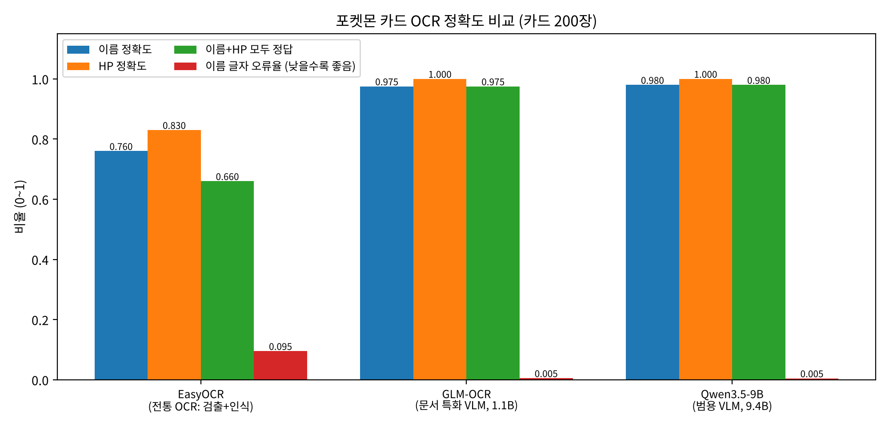
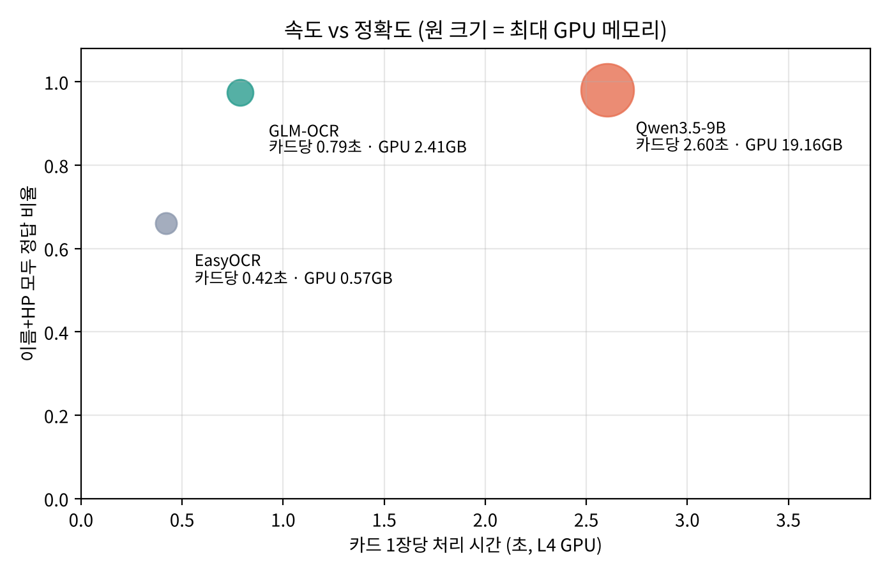
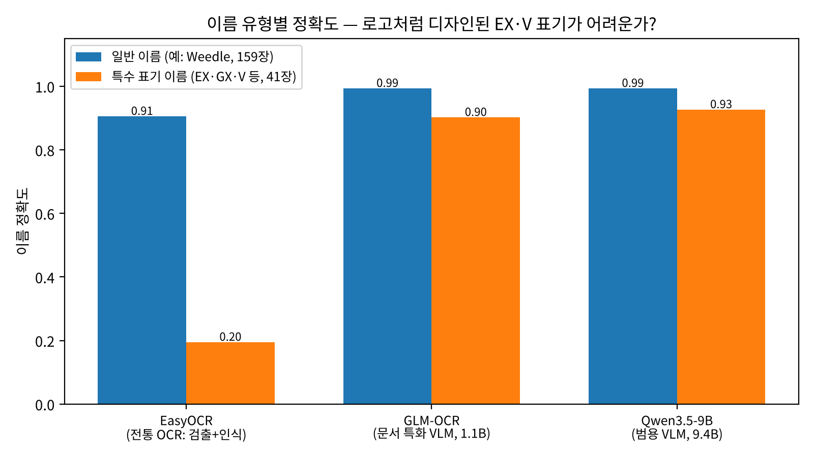
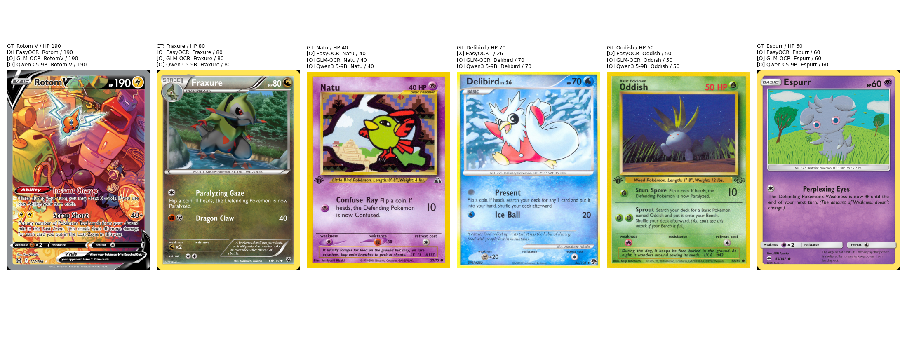

# 7주차 — OCR (광학 문자 인식): 포켓몬 카드에서 이름·HP 읽기

## 목표
강의 19쪽의 OCR 발전 과정(**딥러닝 OCR → VLM 문서 AI**)을 실험 하나로 비교한다.
같은 포켓몬 카드 200장에서 세대가 다른 세 모델이 **카드 이름과 HP**를 얼마나 정확하게, 얼마의 비용으로 뽑는지 측정했다.

## 실험 구성
| 세대 | 모델 | 방식 |
|---|---|---|
| 딥러닝 OCR (CRAFT + CRNN) | EasyOCR | 글자 검출 → 인식 → 규칙(상단의 가장 큰 단어 = 이름)으로 추출 |
| 문서 특화 VLM | `zai-org/GLM-OCR` (0.9B) | JSON 스키마 정보 추출 프롬프트 |
| 범용 VLM | `Qwen/Qwen3.5-9B` (9B) | 자연어 지시 → JSON (thinking 끔) |

- **데이터**: `TheFusion21/PokemonCards` (CC BY-NC 4.0)에서 HP가 숫자인 카드 200장 무작위 추출 (100개 확장팩, 특수 표기 이름 41장)
- **평가**: 이름 정확도(대소문자·기호 무시), 이름 글자 오류율(CER), HP 정확도, 카드당 처리 시간, 최대 GPU 메모리
- **환경**: Colab NVIDIA L4 (24GB), batch=1

## 결과 (카드 200장)

| 모델 | 이름 정확도 | (일반 / 특수표기) | HP 정확도 | **이름+HP** | 카드당 시간 | GPU 메모리 |
|---|---|---|---|---|---|---|
| EasyOCR | 0.760 | 0.906 / 0.195 | 0.830 | 0.660 | **0.42초** | **0.57 GB** |
| GLM-OCR (1.1B) | 0.975 | 0.994 / 0.902 | **1.000** | 0.975 | 0.79초 | 2.41 GB |
| Qwen3.5-9B (9.4B) | **0.980** | 0.994 / 0.927 | **1.000** | **0.980** | 2.60초 | 19.16 GB |

## 배운 점
- **EasyOCR은 글자는 읽지만 '이해'를 못 한다**: 일반 이름 91% vs EX·V 같은 로고형 표기 20%. 카드 설명 문장을 이름으로 고르거나 HP `170`을 `17`로 읽음 → 강의의 CRNN 한계(한 줄 가정, 레이아웃 이해 부족)
- **두 VLM은 사실상 동점(200장 중 1장 차이)이지만 비용은 큰 차이**: Qwen3.5-9B는 GLM-OCR보다 3.3배 느리고 GPU 메모리 8배 → 정해진 항목 추출엔 문서 특화 소형 모델로 충분
- **남은 오답은 '정답 규칙' 문제**: `Raichu GL`의 GL, `Palkia G`의 G는 카드에 로고 아이콘으로 인쇄됨 → 6주차처럼 정답 정의가 점수를 바꾼다
- 비즈니스: 대량은 GLM-OCR, 실패 건만 큰 모델·사람 검수로 넘기는 **2단계 라우팅**이 비용 효율적
- 하드웨어: 9B VLM은 T4(16GB)에 안 들어감. L4는 T4와 메모리 대역폭이 비슷해 생성 속도 이점은 작지만 24GB로 큰 모델을 저렴하게 올릴 수 있음
